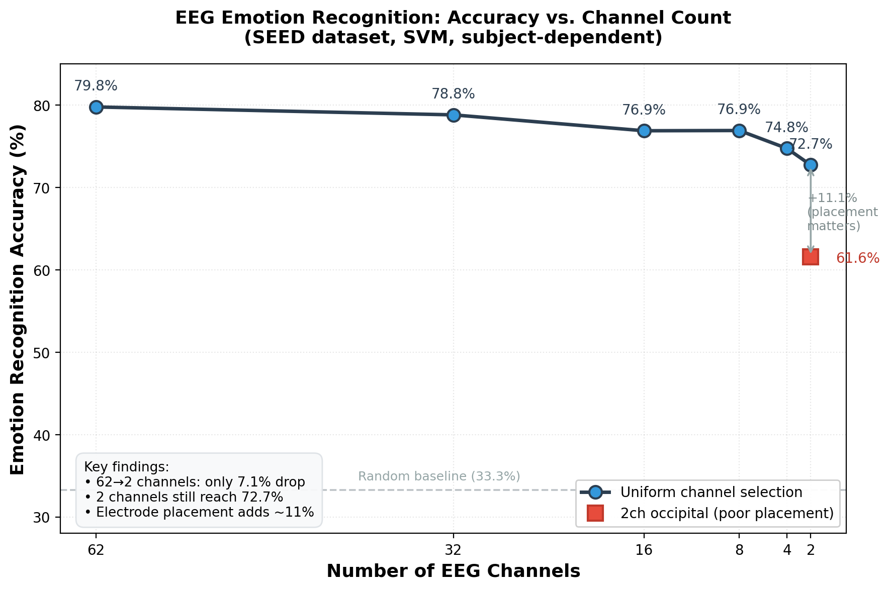
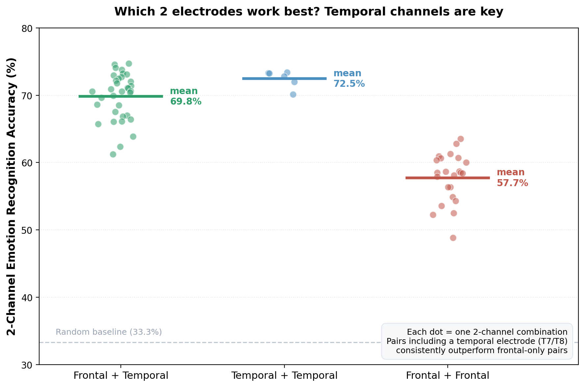

# EEG Emotion Recognition with Minimal Electrodes 🧠

### 少电极脑电情绪识别 — 从 62 通道到 2 通道

> **How few EEG electrodes do we need to recognize emotions — and which ones?**
>
> Using the SEED dataset, this project shows that **2 electrodes retain ~75% of three-class emotion accuracy**, identifies the **optimal 2-electrode pair (F8 + T7)** through an exhaustive search, and demonstrates the result in a **live emotion-monitoring demo**.

**🔴 [Live Demo →](https://ksun10071991-boop.github.io/eeg-emotion-channel-reduction/demo/)** · 实时情绪监测演示

---

## Why this matters | 项目意义

Research-grade EEG uses 62 electrodes. But wearable emotion-sensing devices (Muse, Emotiv, etc.) have only **2–14 electrodes**. This project asks the practical question: **how far can we reduce channels while keeping emotion recognition usable** — and crucially, **which electrode positions matter most** for product design.

研究级脑电用 62 个电极，但可穿戴设备只有 2–14 个。本项目研究：**在保持情绪识别可用的前提下，电极能精简到几个，以及哪些位置最关键。**

## Key Findings | 核心发现

### 1. Channel redundancy — 2 channels retain usable accuracy



Reducing from 62 → 2 channels costs only **~7%** accuracy (79.8% → 72.7%). Emotion-relevant information is highly concentrated.

### 2. Which 2 electrodes? Temporal channels are the key



An **exhaustive search over all 66 two-electrode combinations** (among frontal & temporal candidates) reveals a clear pattern:

| Pair type | Mean accuracy |
|:--|:--:|
| Frontal + Temporal | ~70% |
| Temporal + Temporal | **72.5%** |
| Frontal + Frontal only | 57.7% |

> **Any pair that includes a temporal electrode (T7/T8) outperforms frontal-only pairs by ~12%.** Temporal channels carry emotion information that frontal channels alone miss.

- **Best pair found: `F8 + T7` → 74.7%** (one frontal, one temporal)
- This aligns with how the most successful consumer device (**Muse**) is designed — forehead + behind-ear (near-temporal) placement.

### 3. Placement > count

Two *well-placed* channels (74.7%) beat two *poorly-placed* ones (occipital, 61.6%) by **13 points** — electrode position matters as much as electrode count.

## Live Demo | 实时演示

A browser-based **real-time emotion monitor** that streams real SEED EEG segments through the 2-channel model and outputs emotion predictions segment-by-segment, with instant vs. temporally-smoothed (5-segment majority vote) output and ground-truth comparison.

👉 **[Open the live demo](https://ksun10071991-boop.github.io/eeg-emotion-channel-reduction/demo/)**


## Results Summary | 结果汇总

| EEG Channels | Accuracy |
|:---:|:---:|
| 62 (full) | 79.78% |
| 32 | 78.82% |
| 16 | 76.89% |
| 8 | 76.92% |
| 4 | 74.75% |
| **2 (F8+T7, optimal)** | **74.73%** |
| 2 (occipital, control) | 61.60% |

- **Dataset:** SEED (3-class: positive/neutral/negative), `de_lds` features
- **Model:** SVM, subject-dependent (first 9 trials train / last 6 test)
- **Baseline validity:** 79.78% matches published SEED+SVM results (~75–85%)

## Repository Structure

```
.
├── README.md
├── demo/
│   └── index.html              # Live real-time emotion monitor (GitHub Pages)
├── figures/
│   ├── channel_accuracy_curve.png
│   └── best_2channel_comparison.png
├── results/
│   ├── channel_sweep.csv       # Accuracy at each channel count
│   └── best_2channel_search.csv# Top 2-electrode pairs
├── src/
│   ├── channel_reduction.py    # Core channel-slicing logic
│   ├── search_best_pair.py     # Exhaustive 2-channel search
│   └── realtime_demo.py        # Simulated real-time inference
└── docs/
    ├── method.md
    └── channel_map.md          # SEED 62-channel layout & brain regions
```

## Method | 方法

Built on the [LibEER](https://github.com/XJTU-EEG/LibEER) framework. Channel reduction is done by slicing the channel dimension of the feature tensor after loading, keeping the rest of the pipeline identical — so reduced-channel results are directly comparable to the full-channel baseline. See [`docs/method.md`](docs/method.md).

## Acknowledgements

- **LibEER** framework: https://github.com/XJTU-EEG/LibEER
- **SEED** dataset: BCMI Lab, Shanghai Jiao Tong University

Research / portfolio project, non-commercial academic use.

---

*A personal research project exploring minimal-electrode EEG emotion recognition for wearable applications.*
